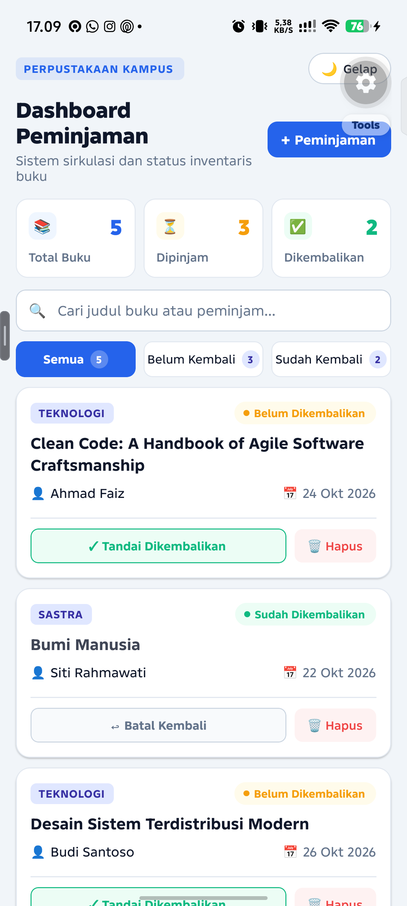
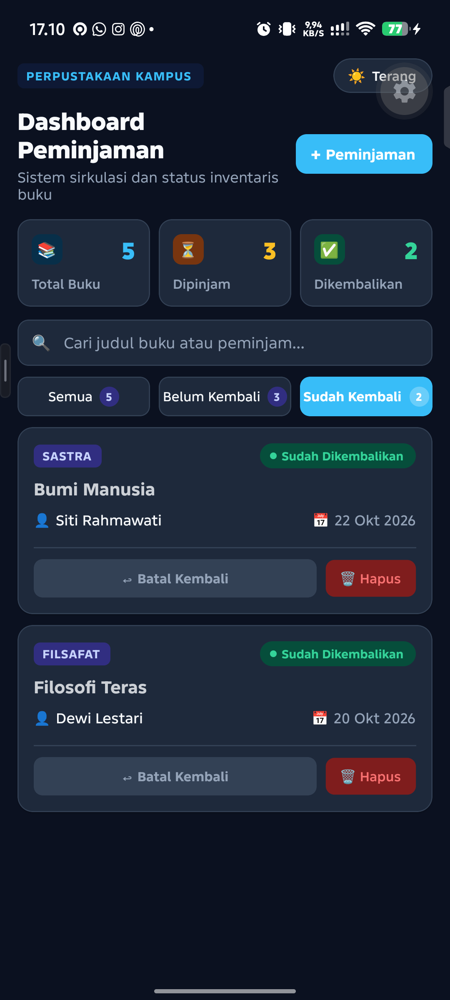
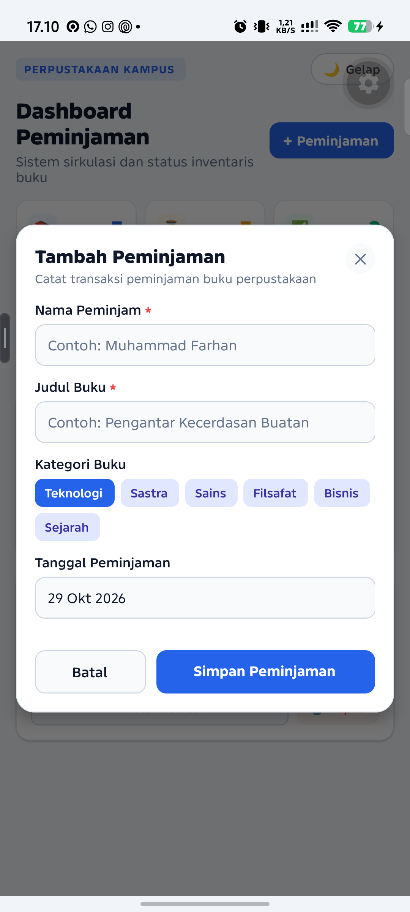
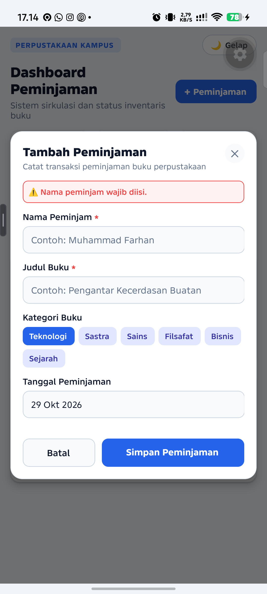
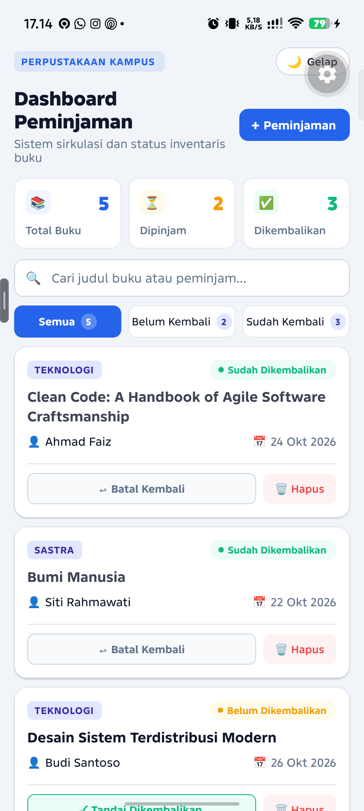
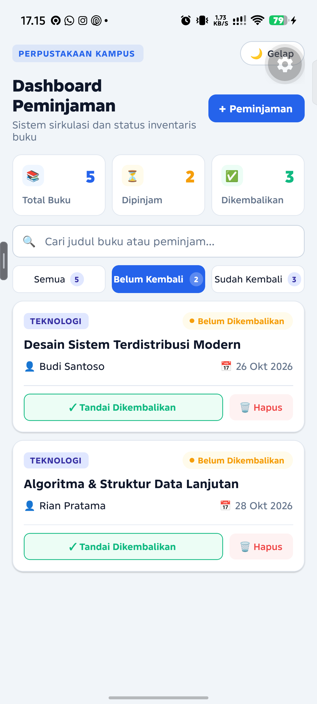

# Dashboard Pengelolaan Peminjaman Buku Perpustakaan

<p align="center">
  
  
  
</p>

<p align="center">
  
  
  
  
</p>

Repositori ini memuat tugas praktik pertemuan 05 mata kuliah Pemrograman Mobile Lanjut pada Program Studi Teknik Informatika, Fakultas Teknologi Informasi. Aplikasi ini mengelola data transaksi peminjaman buku perpustakaan dengan menerapkan prinsip arsitektur state management terstruktur melalui integrasi useReducer dan Context API.

---

## Bukti Tampilan Antarmuka Aplikasi

Tangkapan layar di bawah ini diambil langsung dari pengujian pada perangkat Android riil (Infinix X6885) dengan resolusi asli 1080x2400.

| 1. Dashboard Tema Terang | 2. Dashboard Tema Gelap |
| :---: | :---: |
|  |  |
| *Ringkasan statistik, bilah pencarian, dan daftar buku* | *Tema gelap kontras tinggi untuk kenyamanan visual* |

| 3. Formulir Peminjaman | 4. Validasi Form Input |
| :---: | :---: |
|  |  |
| *Modal input data peminjam dan kategori buku* | *Peringatan validasi saat field wajib belum diisi* |

| 5. Perubahan Status Pengembalian | 6. Filter Data Peminjaman |
| :---: | :---: |
|  |  |
| *Status terbalik dan ringkasan angka terupdate otomatis* | *Penyaringan daftar buku yang belum dikembalikan* |

---

## Uraian Penerapan State Management

### 1. Fungsi dan Peran useReducer

Pengelolaan data transaksi buku menggunakan hook useReducer sebagai pusat kendali perubahan data. Komponen antarmuka tidak memanipulasi array data secara langsung, melainkan mengirimkan aksi tertentu ke fungsi murni loanReducer.

1. Struktur Data Peminjaman: Setiap catatan memiliki atribut id, borrowerName, bookTitle, category, borrowDate, isReturned, dan createdAt.
2. Aksi loan/add: Memasukkan data peminjaman baru ke indeks pertama array secara immutable tanpa merusak data sebelumnya.
3. Aksi loan/toggleStatus: Mengubah status isReturned pada ID buku yang bersangkutan menggunakan metode pemetaan array.
4. Aksi loan/delete: Menghilangkan catatan peminjaman berdasarkan ID menggunakan metode penyaringan array.
5. Aksi filter/set: Mengatur kategori penyaringan aktif, yaitu semua data, buku belum dikembalikan, atau buku sudah dikembalikan.
6. Aksi search/set: Menyaring daftar buku berdasarkan kata kunci nama peminjam, judul buku, maupun kategori secara langsung.

### 2. Fungsi dan Peran Context API

Context API digunakan untuk mendistribusikan data ke seluruh cabang komponen tanpa melalui proses pengiriman properti bertingkat atau prop drilling.

1. Pemisahan State dan Dispatch: LoanStateContext disediakan khusus untuk komponen yang membaca data, sedangkan LoanDispatchContext disediakan untuk komponen yang hanya mengeksekusi aksi. Pemisahan ini meminimalkan render ulang pada komponen yang tidak berkepentingan.
2. Custom Hooks: Disediakan useLoanState() dan useLoanDispatch() yang dilengkapi pengaman kontekstual agar menghasilkan pesan kesalahan yang jelas jika diakses di luar cakupan provider.
3. Manajemen Tema: ThemeContext dipisahkan secara mandiri dari konteks bisnis perpustakaan. Konteks ini menyediakan nilai boolean isDark, palet warna dinamis, serta fungsi toggleTheme().

### 3. Konsistensi Data dan Derived State

Aplikasi mengimplementasikan prinsip single source of truth. Nilai jumlah total buku, jumlah buku yang sedang dipinjam, jumlah buku yang telah dikembalikan, serta daftar buku hasil filter tidak disimpan sebagai state terpisah.

1. Seluruh angka ringkasan pada dashboard dihitung secara langsung dari data utama peminjaman dengan bantuan useMemo.
2. Ketika status sebuah buku diubah dari dipinjam menjadi dikembalikan, angka pada kartu ringkasan di bagian atas otomatis tersinkronisasi tanpa memerlukan penyimpanan data cadangan.

---

## Struktur Berkas dan Direktori

```text
tugas-p5-pemobile/
├── App.tsx                        # Komposisi utama provider dan penanganan SafeArea
├── index.ts                       # Berkas registrasi komponen root Expo
├── app.json                       # Konfigurasi proyek Expo
├── package.json                   # Konfigurasi dependensi dan skrip eksekusi
├── tsconfig.json                  # Konfigurasi compiler TypeScript
├── babel.config.js                # Konfigurasi Babel preset Expo
├── README.md                      # Dokumentasi utama proyek
├── screenshots/                   # Direktori berkas tangkapan layar pengujian
│   ├── 01_dashboard_light.png
│   ├── 02_dashboard_dark.png
│   ├── 03_form_modal.png
│   ├── 04_form_validation.png
│   ├── 05_status_changed.png
│   └── 06_filter_data.png
└── src/
    ├── types/
    │   └── loan.ts                # Definisi antarmuka data, tipe filter, dan jenis aksi
    ├── reducers/
    │   └── loanReducer.ts         # Reducer murni dan inisialisasi data awal
    ├── contexts/
    │   ├── LoanContext.tsx        # Provider pemisahan context state dan dispatch
    │   └── ThemeContext.tsx       # Provider pengelolaan tema terang dan gelap
    ├── components/
    │   ├── DashboardHeader.tsx    # Header aplikasi, tombol pengalih tema, tombol tambah
    │   ├── LoanSummary.tsx        # Tiga kartu ringkasan berbasis derived state
    │   ├── LoanFilter.tsx         # Kolom pencarian dan tombol filter status
    │   ├── LoanItem.tsx           # Kartu detail peminjaman serta tombol aksi
    │   ├── LoanList.tsx           # Komponen FlatList dan penanganan tampilan kosong
    │   └── LoanFormModal.tsx      # Modal dialog formulir input dengan validasi
    └── screens/
        └── DashboardScreen.tsx    # Layar utama yang menyatukan seluruh komponen
```

---

## Panduan Menjalankan Aplikasi

Aplikasi dapat dijalankan secara instan tanpa perlu melakukan kompilasi biner manual melalui lingkungan Expo Go.

### Langkah Persiapan dan Menjalankan

1. Mengunduh atau mengkloning repositori:
   ```bash
   git clone <url-repositori>
   cd <nama-folder-repositori>
   ```

2. Memasang seluruh dependensi pustaka:
   ```bash
   npm install
   ```

3. Memulai server pengembangan Metro:
   ```bash
   npx expo start
   ```

4. Menjalankan pada perangkat pilihan:
   1. Pengujian di HP Fisik Android atau iOS: Buka aplikasi Expo Go pada ponsel, lalu pindai kode QR yang tampil pada layar terminal.
   2. Pengujian di Emulator Android: Tekan tombol huruf "a" pada jendela terminal saat Metro berjalan.
   3. Pengujian di Peramban Web: Tekan tombol huruf "w" pada jendela terminal untuk membuka antarmuka pada browser.

### Opsi Berkas APK Siap Pasang

Bagi dosen atau penguji yang ingin menguji aplikasi langsung dalam bentuk instalasi berkas APK mandiri (standalone package) tanpa melalui Expo Go:

1. Unduh berkas APK yang telah disediakan pada menu GitHub Releases di repositori ini.
2. Pasang berkas APK tersebut langsung pada ponsel Android dengan mengizinkan instalasi aplikasi dari sumber tepercaya.
